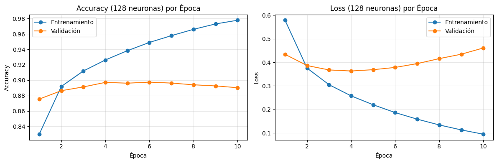
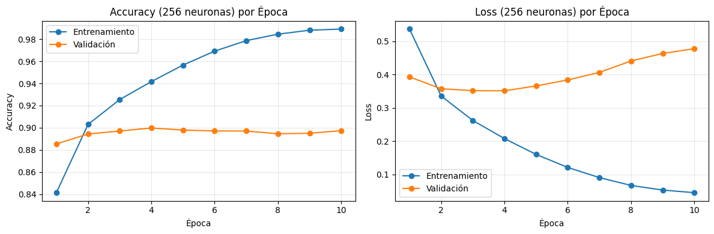
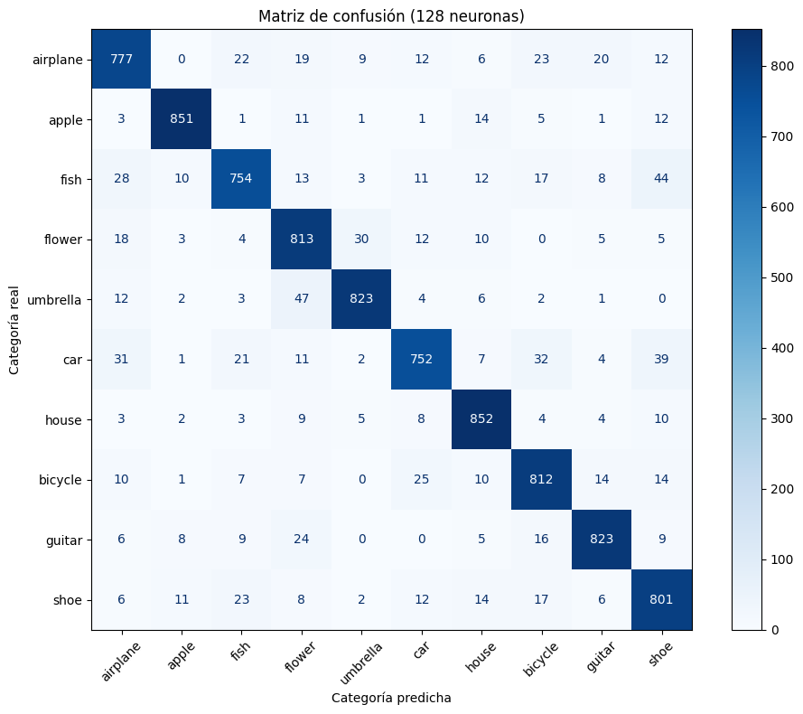
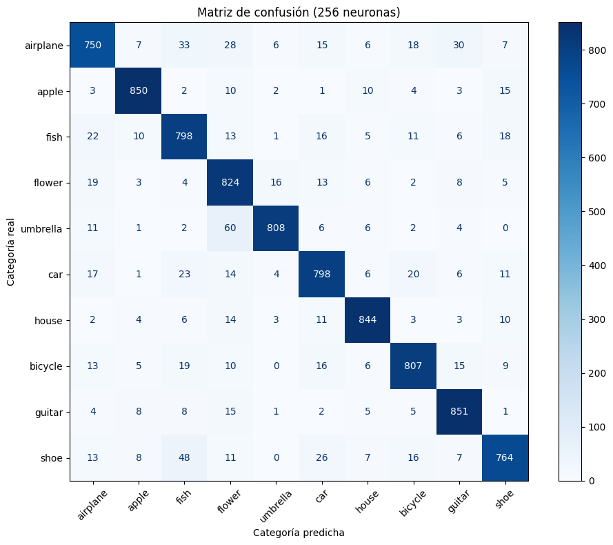

# Clasificación de dibujos con Quick, Draw!

Proyecto de clasificación multiclase de imágenes mediante redes neuronales densas. El objetivo es reconocer dibujos pertenecientes a diez categorías del dataset Quick, Draw! y comparar dos arquitecturas con diferente cantidad de neuronas ocultas.

📓 [Ver el notebook completo](quick_draw_classifier.ipynb)

## Descripción

Se utilizaron 60.000 dibujos de 28 × 28 píxeles, distribuidos equitativamente entre las siguientes categorías:

- Airplane
- Apple
- Fish
- Flower
- Umbrella
- Car
- House
- Bicycle
- Guitar
- Shoe

El problema corresponde a aprendizaje supervisado, ya que cada imagen está asociada previamente con su categoría correcta.

## Objetivos

- Preparar y explorar un subconjunto del dataset Quick, Draw!
- Entrenar una red neuronal para clasificación multiclase.
- Comparar modelos con 128 y 256 neuronas ocultas.
- Evaluar accuracy, pérdida, duración y capacidad de generalización.
- Analizar predicciones y matrices de confusión.
- Probar los modelos con dibujos propios.

## Dataset

El dataset fue creado por Google Creative Lab y contiene dibujos realizados por usuarios del juego Quick, Draw!

Para este proyecto se seleccionaron aleatoriamente 6.000 imágenes de cada categoría:

| Conjunto | Imágenes | Porcentaje |
|---|---:|---:|
| Entrenamiento | 42.000 | 70 % |
| Validación | 9.000 | 15 % |
| Prueba | 9.000 | 15 % |
| **Total** | **60.000** | **100 %** |

Las imágenes se descargan automáticamente desde la fuente oficial, por lo que el dataset no se almacena en este repositorio.

Fuente: [Google Quick, Draw! Dataset](https://github.com/googlecreativelab/quickdraw-dataset)

## Arquitecturas

Se compararon dos redes neuronales densas:

```text
Modelo 1: Flatten → Dense(128, ReLU) → Dense(10, Softmax)
Modelo 2: Flatten → Dense(256, ReLU) → Dense(10, Softmax)
```

Ambos modelos utilizaron:

- 10 épocas.
- Batch size de 32.
- Optimizador Adam.
- Tasa de aprendizaje de 0.001.
- Función de pérdida `sparse_categorical_crossentropy`.
- Semilla aleatoria 42.

## Resultados

| Modelo | Parámetros | Accuracy de prueba | Loss de prueba | Duración |
|---|---:|---:|---:|---:|
| 128 neuronas | 101.770 | 89,53 % | 0,4639 | 48,99 s |
| 256 neuronas | 203.530 | 89,93 % | 0,5128 | 61,53 s |

El modelo de 256 neuronas consiguió 36 predicciones correctas adicionales, pero presentó una pérdida mayor, necesitó más tiempo de entrenamiento y utilizó aproximadamente el doble de parámetros.

### Curvas de entrenamiento

#### Modelo de 128 neuronas



#### Modelo de 256 neuronas



Las curvas muestran señales de sobreajuste aproximadamente después de la cuarta época. El rendimiento sobre los datos de entrenamiento continúa mejorando, pero la pérdida de validación comienza a aumentar.

## Modelo recomendado

Se recomienda el modelo de **128 neuronas** porque ofrece el mejor equilibrio entre precisión, pérdida, duración y complejidad.

La diferencia de accuracy respecto del modelo de 256 neuronas es de solo 0,40 puntos porcentuales, mientras que el modelo más pequeño:

- Entrena más rápido.
- Utiliza menos parámetros.
- Presenta una pérdida de prueba menor.
- Mantiene un desempeño cercano al modelo de 256 neuronas.

Si el único objetivo fuera maximizar la cantidad de predicciones correctas, el modelo de 256 neuronas sería la alternativa seleccionada.

## Matrices de confusión

Las matrices de confusión permiten identificar las categorías reconocidas correctamente y las confusiones más frecuentes.

### Modelo de 128 neuronas



### Modelo de 256 neuronas



En el modelo de 128 neuronas, las categorías con mayor cantidad de aciertos fueron `house`, `apple`, `umbrella` y `guitar`.

## Pruebas con dibujos propios

Además del conjunto de prueba, los modelos fueron evaluados con diez dibujos propios almacenados en `sample_drawings/`.

Esta prueba mostró un rendimiento inferior al obtenido con el dataset original. Los dibujos externos presentan diferencias de estilo, grosor y forma respecto de las imágenes utilizadas durante el entrenamiento.

Esta evaluación es complementaria y no reemplaza los resultados obtenidos con las 9.000 imágenes del conjunto de prueba.

## Tecnologías

- Python
- TensorFlow
- Keras
- NumPy
- Pandas
- Matplotlib
- Scikit-learn
- Pillow
- Jupyter Notebook

## Estructura

```text
quickdraw-neural-network-classifier/
├── quick_draw_classifier.ipynb
├── README.md
├── requirements.txt
├── .gitignore
├── LICENSE
├── assets/
│   ├── confusion_matrix_128.png
│   ├── confusion_matrix_256.png
│   ├── training_128.png
│   └── training_256.png
└── sample_drawings/
    ├── img_0.jpg
    ├── ...
    └── img_9.jpg
```

## Ejecución

Clonar el repositorio:

```bash
git clone https://github.com/paulavalencia09/quickdraw-neural-network-classifier.git
cd quickdraw-neural-network-classifier
```

Instalar las dependencias:

```bash
pip install -r requirements.txt
```

Abrir el notebook:

```bash
jupyter notebook quick_draw_classifier.ipynb
```

La primera ejecución descargará automáticamente los archivos correspondientes a las diez categorías de Quick, Draw!

## Limitaciones

- Solo se utilizaron diez de las 345 categorías disponibles.
- La arquitectura utiliza capas densas y no aprovecha completamente la estructura espacial de las imágenes.
- Se observaron señales de sobreajuste.
- La evaluación externa se realizó con solo diez dibujos propios.
- El rendimiento depende de la similitud entre los dibujos nuevos y el dataset de entrenamiento.

## Licencias y atribución

El código de este repositorio se distribuye bajo la licencia MIT.

El dataset Quick, Draw! pertenece a Google Creative Lab y se encuentra disponible bajo la licencia Creative Commons Attribution 4.0.
